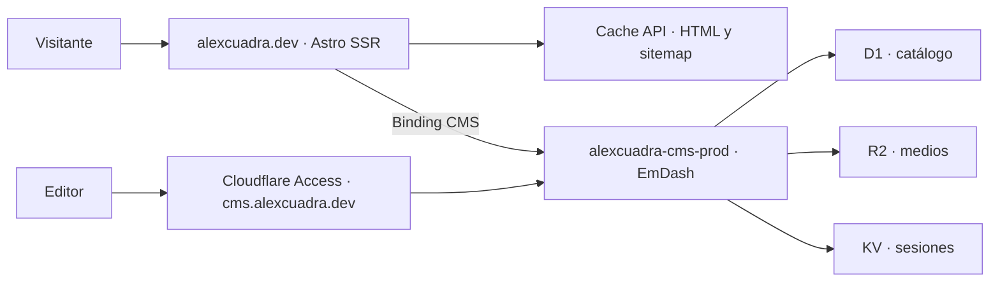

# Alex Cuadra · Astro y EmDash

El portfolio de Alex Cuadra es un sitio bilingüe en Astro con renderizado en servidor (SSR). EmDash gestiona el catálogo desde un panel editorial separado. Ambos se ejecutan en Cloudflare Workers. WordPress se conserva como origen histórico de la migración y opción de reversión. [alexcuadra.dev](https://alexcuadra.dev)



## Infraestructura de producción

| Componente | Recurso | Función |
| --- | --- | --- |
| Frontend | Worker `alexcuadra-dev` | Sirve páginas SSR en inglés y español, archivos estáticos, sitemap y redirecciones históricas. |
| CMS | Worker `alexcuadra-cms-prod` | Aloja el panel en `cms.alexcuadra.dev`, protegido por Cloudflare Access y la autenticación de EmDash. |
| Base de datos | D1 `alexcuadra-catalog-prod` | Guarda páginas, proyectos, Blog, LAB y referencias, junto con revisiones, traducciones y taxonomías. |
| Medios | R2 `alexcuadra-media-prod` | Guarda los archivos. El CMS comprueba que se usan en contenido publicado antes de servirlos. |
| Sesiones | KV `alexcuadra-cms-prod-session` | Guarda las sesiones del CMS. |

## Lectura, caché y publicación

Astro consulta `/api/content-v1.json` por el binding privado `CMS`. El contrato devuelve solo contenido publicado. El frontend sirve las imágenes bajo su propio dominio y usa credenciales separadas para contenido y medios.

El Worker guarda las respuestas elegibles de HTML y sitemap en Cache API por hasta 60 segundos. La caché se separa por ruta y versión y es local a cada centro de datos de Cloudflare. Una respuesta vigente se sirve directamente desde caché y evita otra consulta al CMS y otro renderizado de Astro.

EmDash guarda los cambios como borradores. Las páginas cacheadas reflejan una publicación o retirada al vencer ese plazo. La purga automática al publicar queda pendiente. Las páginas de contacto ofrecen un enlace directo al correo y el formulario está deshabilitado.

## Código y desarrollo local con EmDash

Este repositorio contiene el frontend Astro. En el equipo de desarrollo, la rama `codex/emdash-cutover` está en la copia de trabajo `.local/frontend-reconciliation/` dentro del proyecto del CMS. Desde esa copia, `npm run build:emdash-candidate` genera el build SSR y el manifiesto de Wrangler.

El proyecto separado `alexcuadradev` contiene el CMS, su esquema, los contratos de lectura y las herramientas de migración y verificación. Allí, `local/real-cms/` contiene el catálogo migrado y las configuraciones de Astro están en la raíz.

Desde la raíz del proyecto del CMS, instala dependencias con `pnpm install` y arranca la plantilla con `pnpm dev`. El panel local de la plantilla está en el puerto `4322`. `pnpm dev:real` arranca el catálogo migrado en el puerto `4323`. [Panel local](http://127.0.0.1:4322/_emdash/admin)

En el proyecto del CMS, `docs/CORTE-Y-REVERSIÓN.md` documenta el despliegue, las verificaciones y la reversión. `docs/RESPALDO-Y-RESTAURACION.md` cubre la recuperación de datos y archivos. Las credenciales, respaldos y recibos privados se guardan fuera del control de versiones.

<details>
<summary>Guía de desarrollo con WordPress</summary>

Esta guía corresponde al código en `main`. El despliegue de producción con EmDash se preparó desde `codex/emdash-cutover`.

## Stack

- Astro 7 con renderizado en servidor (SSR) y TypeScript.
- Tailwind CSS 4 mediante su integración Vite.
- Cloudflare Workers con Wrangler 4.
- WordPress en `content.alexcuadra.dev`, WPGraphQL y WPGraphQL for ACF.
- ACF gratuito para el modelo editorial previsto.

Todo el contenido editorial del rediseño se administrará en WordPress. Los mockups son referencias de diseño; sus cifras no son datos reales del portfolio.

## Desarrollo local

Usa Node.js **22.23.2**, declarado en `.nvmrc` (requisito mínimo: 22.22.0), y npm.

```sh
nvm use
npm ci
npm run dev -- --host 127.0.0.1
```

Si no utilizas nvm, instala la versión indicada de Node con tu gestor habitual. Abre [localhost:4321](http://127.0.0.1:4321/). El servidor utiliza el runtime de Workers; las páginas necesitan acceso al CMS.

Para comprobar el build local:

```sh
npm run build
npm run preview -- --host 127.0.0.1 --port 4321
```

Detén el servidor de desarrollo antes de usar el mismo puerto para preview. Para detener el preview gestionado por Astro: `npm run astro -- preview stop`.

## Comandos

| Comando | Función |
| --- | --- |
| `npm ci` | Instala las versiones fijadas en el lockfile. |
| `npm run dev` / `npm start` | Arranca el servidor de desarrollo. |
| `npm test` | Ejecuta pruebas deterministas sin CMS ni credenciales reales. |
| `npm run check` | Revisa tipos y archivos Astro. |
| `npm run build` | Imprime revisión/versiones, valida y compila para Workers. |
| `npm run build:production` | Compila para el Worker de producción propuesto, sin desplegar. |
| `npm run preview` | Sirve el build local con el runtime de Workers. |
| `npm run test:smoke` | Comprueba el favicon y siete páginas en localhost:4321. |
| `npm run test:smoke -- https://dominio` | Ejecuta las mismas comprobaciones contra un destino explícito. |
| `npm run deploy:staging` | Compila y despliega al Worker definido en `wrangler.jsonc`; requiere acceso autorizado a Cloudflare. |

Los smoke tests usan contenido publicado del CMS y necesitan un proyecto, una categoría y un artículo disponibles. No son pruebas de carga; evítalos repetidamente mientras se investiga el límite de solicitudes. Un build correcto no garantiza disponibilidad del CMS ni funcionamiento completo en producción.

## Entornos y despliegue

| Entorno | Estado |
| --- | --- |
| Producción — [alexcuadra.dev](https://alexcuadra.dev/) | Worker `alexcuadra-dev`, entorno Wrangler `production`, conectado a `codex/workers-upgrade` durante la migración. Pages se conserva como respaldo. |
| Staging — [Workers](https://alexcuadra-dev-staging.alexcu21.workers.dev/) | Worker `alexcuadra-dev-staging`, conectado a `codex/workers-upgrade`. |

El staging está desplegado, pero su validación continúa: se han observado errores HTTP 429 y 500 procedentes del CMS. Los fallos reconocidos del CMS se convierten en 503 sin caché, con diagnósticos estructurados en Observability. Las consultas repetidas se deduplican dentro de cada petición. Home, proyectos y categorías públicos usan además una caché de datos de 60 segundos por centro de datos; cookies, autorización y previews la omiten. La política y sus límites se describen en [CMS: caché y diagnóstico](docs/CMS_CACHE.md).

Workers Builds usa `npm run build` y después `npx wrangler deploy`, con la raíz del repositorio como directorio de trabajo. El nombre del Worker debe coincidir con `wrangler.jsonc`. Las respuestas SSR bajo `workers.dev` incluyen `noindex`; esto no es control de acceso.

El dominio público ya está asociado al Worker y validado por HTTP con autenticación. Antes de fusionar en `main`, desactivar los builds automáticos del antiguo Pages y coordinar el cambio de rama del Worker de producción. La configuración de esta rama está preparada para Workers; no sirve para desplegar de nuevo en Pages.

## Pruebas y CI

Las pruebas cubren contratos del cliente GraphQL, variables, errores de autorización/HTTP/red, timeouts, contenido Home ausente, diagnósticos sin datos sensibles, manejo 503, deduplicación por petición y orden de proyectos por fecha.

[El workflow de CI](.github/workflows/ci.yml) instala con `npm ci`, ejecuta `npm test` y `npm run build` en pull requests y pushes a `main` o `codex/workers-upgrade`. No despliega ni requiere secretos de producción. Las pruebas smoke contra el CMS se ejecutan por separado.

## Configuración y seguridad

El cliente consulta `https://content.alexcuadra.dev/graphql` mediante Application Password, `WPGRAPHQL_AUTH_ENABLED=true` y credenciales de runtime. **WPGraphQL exige autenticación**, validada en producción Workers, staging y local. El modo anónimo del cliente solo es compatible si el CMS vuelve a permitirlo; consultar la [guía de autenticación y reversión](docs/CMS_AUTH.md). Solo proyectos autenticados tienen caché compartida, con un contrato de campos públicos y controles de publicación/contraseña/restricción; Home verifica la identidad en origen.

No guardar tokens, Application Passwords ni credenciales en Git, contenido ACF, logs o variables `PUBLIC_*`. `.env`, sus variantes y `.dev.vars` están ignorados, salvo `.env.example`. Los secretos futuros se configurarán en el runtime del Worker, separados por entorno. No registrar respuestas crudas del CMS para diagnosticar fallos.

Los CPT actuales de proyectos y artículos proceden de un plugin custom. Su transición al registro de ACF requiere inventario, backup y validación; no desactivar ese plugin como parte de la migración frontend.

## Documentación

Los planes, guías y documentos de seguimiento se guardan en `docs/`:

- [Plan de rediseño](docs/REDESIGN_PLAN.md): contenido bilingüe, templates, LAB, migración CPT/ACF, seguridad, SEO y soporte Gutenberg.
- [Estado de ejecución](docs/EXECUTION_STATUS.md): comprobaciones realizadas, incidentes y tareas pendientes.
- [Guía de Workers staging](docs/WORKERS_STAGING.md): configuración y validación del entorno paralelo.
- [Migración de producción a Workers](docs/WORKERS_PRODUCTION.md): entorno separado, pasos de creación, traslado del dominio y reversión.

Las referencias de diseño bajo `docs/design-proposal/` permanecen locales y están excluidas de Git. Las colecciones Markdown heredadas se conservan durante la transición; no son la fuente editorial prevista para el rediseño.

</details>
