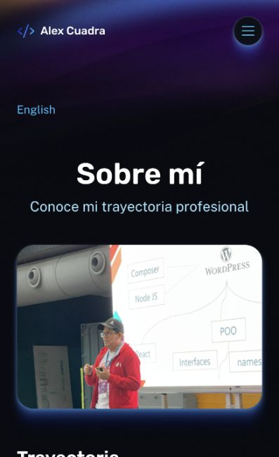
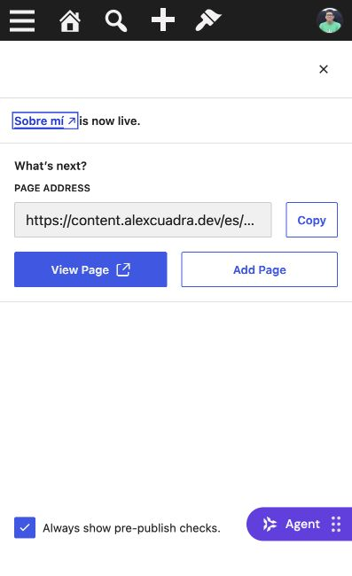

# Sobre mí publicado — 19 octubre 2026

## Recuperación verificada después del aviso de Alex

Nueva carga de navegador correcta: contenido ES, imagen, CTA y footer traducidos; lang=es y anchura 397 px sin desbordamiento. Verificación dirigida HTTP200 en `/about/`, `/es/sobre-mi/` y la ficha de Medium que falló antes. Se cierra la revisión visual móvil pendiente; no se atribuye una solución permanente al límite 429 ni se repite toda la matriz.

Versión staging: `79295da5-ea63-4d54-8a81-c832d715b1c6`.

- CMS compartido: página 191 Sobre mí, idioma ES, publicada mediante Add translation desde About 68. Relaciones recíprocas confirmadas por GraphQL como 68 EN↔191 ES.
- Traducidos los dos párrafos originales y los campos introText y education; skillsText conserva nombres técnicos PHP, WordPress, Vue, React. No se añadieron experiencia, cursos ni cifras nuevas; la mención de cinco años procede del original EN y no se reevaluó editorialmente.
- Grupo ACF About_Page ID64 (`group_67707e6a6a0df`): regla original Page=68 preservada; añadido OR Page=191 para que los campos aparezcan en la traducción. Keys y tipos sin cambios.
- Staging `/es/sobre-mi/` resuelve la traducción real. Menú ES usa Sobre mí y destino ES solo al encontrar página pública; conserva fallback identificado como EN si se retira. El selector/hreflang EN/ES aparece con ambas fuentes válidas.
- Ajustada columna del hero y selector en desktop para que añadir navegación no cambie su colocación. CTA ES mailto, sin formulario EN.
- 134 pruebas pasan y build staging correcto. Smoke de nueve páginas ampliado con `--check-about-es`, sustituyendo la comprobación histórica de ausencia para este estado publicado.
- Smoke confirmó About EN/ES, campos, CTA, canonical y alternates (`PASS About EN/ES`), además de privacidad y contacto false. La matriz no pasó completa: la ficha de Medium devolvió 503. La revisión visual posterior también recibió 503; tail identificó upstream HTTP429 en LocalizedAbout, requestId `e8d8fc2d-265d-4053-864e-800725143c29`. No atribuir esto a fallo de traducción ni declarar resuelto el límite del hosting.
- No se desplegó producción. La publicación editorial sí ocurrió en WordPress compartido. Contacto sigue desactivado y no se enviaron correos.

Próximo incremento: traducción real de Home y template ES, conservando idiomas/categorías de referencias según la decisión de Alex.

Tras enfriamiento, una nueva lectura de navegador todavía devolvió 503. No se continuó recargando ni se modificaron controles del hosting. Pendiente revisar regla/límite de Hostinger y completar QA visual cuando el CMS vuelva a responder. La traducción no se revierte por este rechazo de solicitudes.

