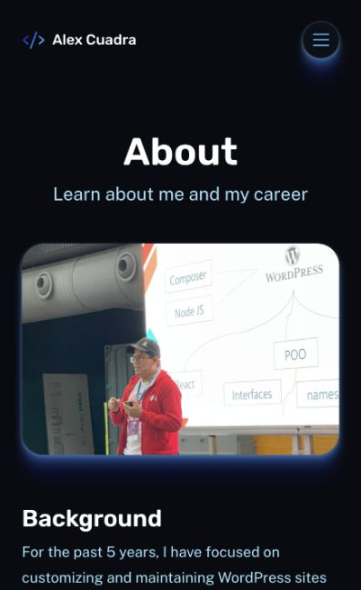

# About localizado — 19 octubre 2026

Versión staging: `58e0748e-265d-4956-83bd-fb256177d23f`.

- Consulta autenticada de lectura confirma About 68 en EN, título About, campos introText/education/skillsText y contenido público; translations vacío. No se modificó WordPress.
- About EN usa localizedPage en lugar de selección legacy; comparte AboutPage con la nueva ruta `/es/sobre-mi/`. Descripción SEO procede de introText, sin Lorem Ipsum.
- ES resuelve exclusivamente la relación publicada de Polylang desde 68. Sin traducción devuelve 404, no-store y noindex; no se anuncia link ni hreflang ES en EN. La consulta sigue usando filtros de visibilidad antes de leer ACF de traducciones.
- Encabezados y CTA en español preparados. CTA ES solo mailto: no se carga el formulario EN en una página española. Imagen opcional evita fallo cuando el CMS no la proporciona. HTML editorial pasa por el renderer sanitizado común.
- 134 pruebas unitarias pasan; build con cero errores y seis hints legacy. Navegador verifica About EN, contenido y CTA.
- Smoke remoto añade `--check-about-es-absent` a la matriz existente para comprobar el estado real de ausencia y evitar fallback inglés/alternates inexistentes.

Siguiente paso editorial: crear traducción de About 68 en Polylang, revisar contenido y campos introText, education y skillsText en español y publicar con la relación correcta. No se inventaron trayectoria ni credenciales. Después validar render ES y enlaces recíprocos antes de añadirlo al menú español.

Producción no desplegada, contacto false y prueba de correo aplazada. No se declara validado visualmente el template ES con contenido real todavía ausente.

