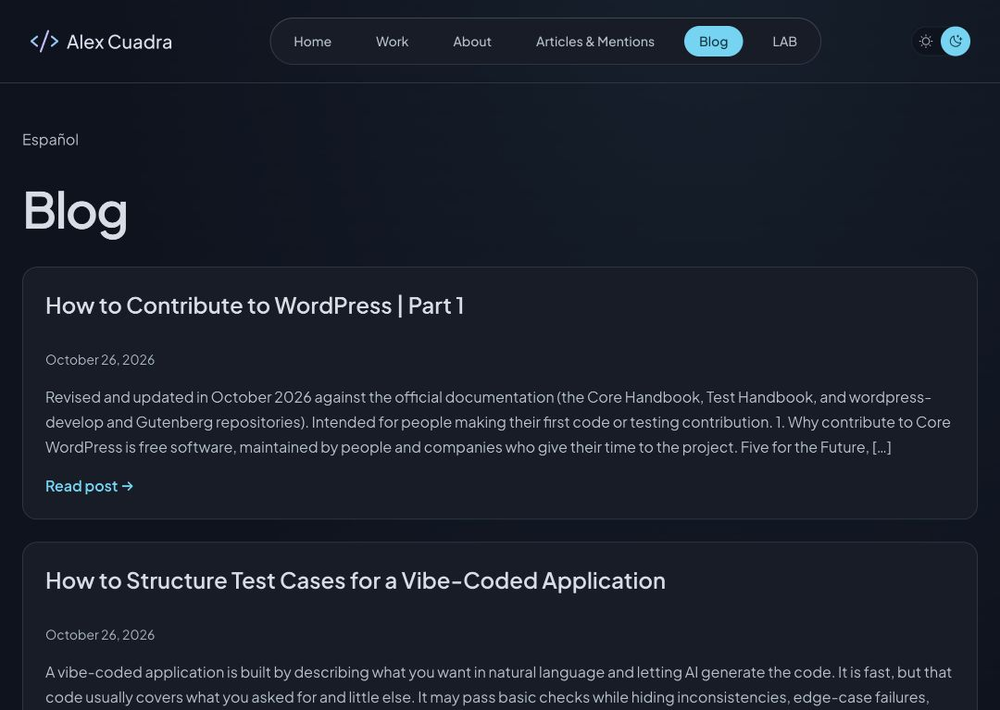

# Traducciones inglesas del blog

Fecha local: 25 octubre 2026. Publicación UTC: 26 octubre 2026, 02:03.

El inventario encontró dos entradas publicadas en español y ninguna traducción inglesa pública. ES204 conservaba una relación administrativa con el ejemplo EN202 en la papelera. Se retiró esa relación desde el editor y se creó una traducción completa del artículo actual; EN202 permanece recuperable en la papelera.

## Publicaciones

| Original | Traducción publicada | Categoría EN | Etiqueta EN |
| --- | --- | --- | --- |
| ES228 | EN239 — How to Contribute to WordPress, Part 1 | OpenSource, 46 | WordPress, 3 |
| ES204 | EN241 — How to Structure Test Cases for a Vibe-Coded Application | Testing, 48 | Vibecoding, 50 |

- https://alexcuadra.dev/blog/how-to-contribute-to-wordpress-part-1
- https://alexcuadra.dev/blog/how-to-structure-test-cases-for-a-vibe-coded-application

Mutaciones realizadas mediante la sesión existente del editor de WordPress. Sin cambios en permisos, plugins, credenciales, proyectos, referencias editoriales ni configuración del formulario. Las dos versiones inglesas se publicaron como entradas nuevas, con fecha de publicación actual y relaciones recíprocas EN/ES.

## Validación

- Auditoría GraphQL de lectura posterior: cuatro entradas publicadas, dos por idioma, pares 228↔239 y 204↔241, categorías y etiquetas inglesas correctas, sin restricciones ni contraseña.
- Comparación local de auditorías: títulos, cuerpos renderizados, extractos, slugs, fechas originales, imágenes y asignaciones de categorías/etiquetas de ambas entradas españolas idénticos. ES204 cambia su fecha de modificación por la reparación de la relación.
- Traducción íntegra conservando estructura Gutenberg, orden de etiquetas HTML, tablas, listas, imágenes y destinos de enlaces. El preflight comprueba la estructura y preserva los bloques de código salvo comentarios/placeholders localizados explícitamente. La numeración inglesa de la guía de contribución se normaliza de 1 a 9; el original permanece intacto.
- Traducciones del contenido aportado por el autor; no es una revisión independiente de sus afirmaciones técnicas o cifras.
- Pasada HTTP secuencial: producción `/blog/`, `/es/blog/` y las cuatro fichas devolvieron 200; el script comprobó títulos, inclusión de ambos artículos en cada listado y alternates hacia la traducción correcta. Staging `/blog/` también 200; `/es/blog/` devolvió 503 y detuvo la pasada. No se ejecutaron las cuatro fichas de staging después del fallo.
- Navegador: listado inglés de producción muestra ambos artículos y enlace a español. Una visita posterior a la ficha inglesa de pruebas devolvió la pantalla de indisponibilidad temporal. El problema upstream sigue abierto; no se afirma disponibilidad estable ni aceptación integral. Sin bucles de reintento ni cambios para eludir el limitador.
- El script HTTP temporal abortó antes de guardar su JSON agregado; el resultado anterior procede de las aserciones completadas antes del fallo, no de un recibo HTTP persistente. Auditorías CMS, fuentes originales, traducciones y preflight sí se guardan en `docs/wordpress/`.
- No cambió código frontend; no se requiere build ni despliegue: Astro SSR lee las publicaciones del CMS. Producción continúa en `feba64f8-5406-4c69-8522-6c3753681a37`, staging en `a9b314e7-aca3-4403-8038-4776ef215d6a`.

## Reversión

Si el autor solicita retirar las traducciones, cambiar EN239 y EN241 a borrador desde WordPress. No restaurar el ejemplo obsoleto EN202 ni modificar los cuerpos españoles. Conservar los respaldos locales. La revisión pendiente es disponibilidad estable y aceptación visual de las fichas cuando el origen se recupere.
