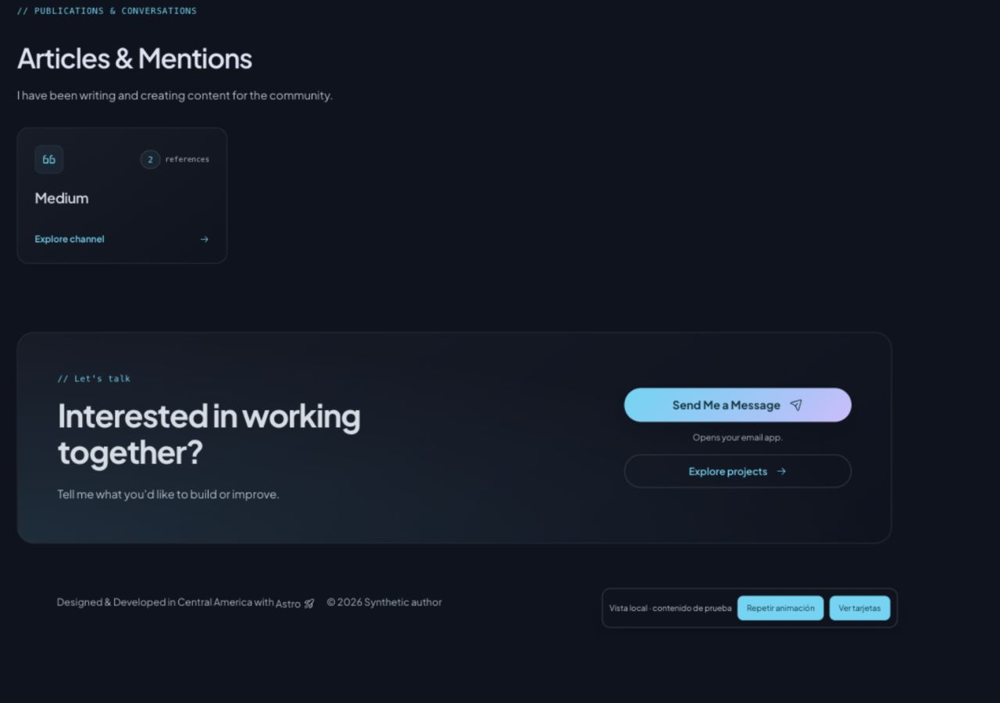
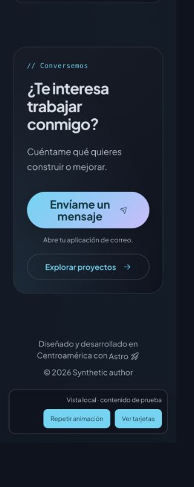
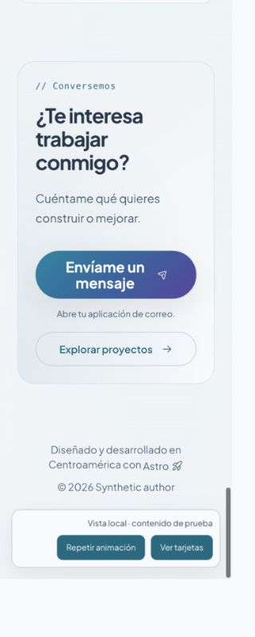
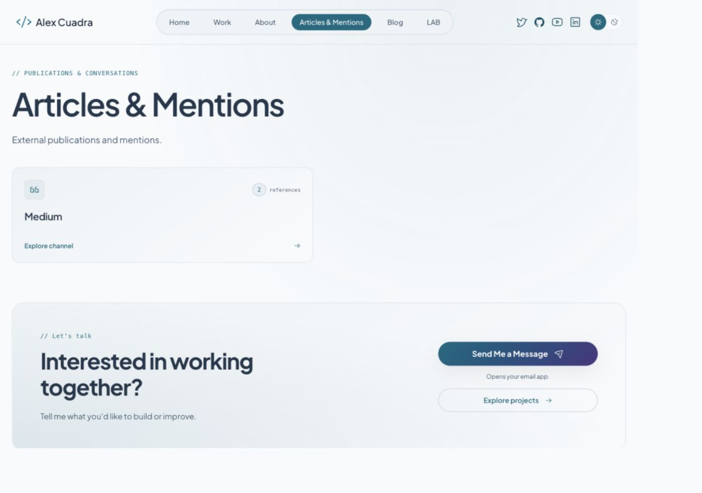

# Canales editoriales y contacto — 24 octubre 2026

Implementación local. No despliegue, cambios CMS ni SSH. Contacto sigue sin formulario ni Turnstile; no se abrió el enlace de correo ni se enviaron mensajes.

## Entrega

- ReferenceChannelCard compartida por Home EN/ES y `/articles/`: canal, icono, número de referencias públicas y enlace existente. Reutiliza el cálculo de referencias, no el contador genérico de entradas de WordPress. No añade consultas.
- Archivo con cabecera técnica, tarjetas y entrada discreta mediante el controlador Motion existente; Home conserva su animación de tarjetas. Sin dependencias nuevas.
- CTA compartido con degradado, invitación, acción de correo explicada y enlace de proyectos localizado. No anuncia disponibilidad laboral ni introduce formulario.
- Home omite el bloque editorial vacío y el archivo muestra un mensaje explícito. No se inventaron publicaciones ni métricas para llenar la maqueta.

## Verificación

`REFERENCES_SSR_PORT=4399 npm run test:references-ssr` correcto: templates reales con fuente sintética, rutas, conteo2, CTA EN/ES, ausencia de formulario/Turnstile y vacíos, además de las regresiones anteriores. `npm run build` correcto:174 archivos Astro,0errores/advertencias/hints del comprobador. Persisten avisos de configuración Shiki/CSP conocidos; no se modificaron protecciones.

Navegador local con datos sintéticos: Home1280CSS oscuro; CTA320CSS ES oscuro/claro; archivo1280CSS claro. En Home EN1280 y ES320 `scrollWidth === innerWidth`. Acción secundaria ES apunta a `/es/proyectos/`, EN a `/work/`; correo de fixture preservado. Tarjeta Medium abre el canal con las dos referencias de prueba. Tema oscuro restaurado, viewport restablecido y pestaña de Home conservada para revisión. Servidor4398 existente conservado; suite4399 finalizada.

No constituye QA integral de todas las páginas que comparten CTA ni postflight de Worker. Pendientes: revisión conjunta con contenido real, zoom200%, aceptación integral y eventual staging agrupado. Búsqueda/filtros editoriales y contenido más profundo de casos siguen separados del diseño actual. MCP permanece aplazado.

## Evidencia

## Almacenamiento

Sin paquetes, imágenes de producto, descargas ni respaldos nuevos. Solo código, evidencia y regeneración de dist existente. Volumen al cierre:36GiB disponibles. Las capturas son evidencia local sintética, no publicaciones del CMS.
