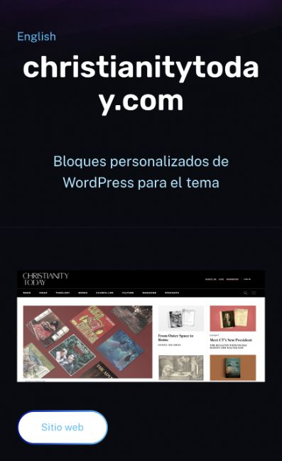

# Christianity Today EN/ES — 19 octubre 2026

Versión final staging: `b05945c8-00ff-477d-99e3-754b3e0f1648`. Recarga de navegador confirma título completo en varias líneas tras el ajuste, sin recorte lateral.

- Contenido procede de confirmación de Alex: contratista externo, frontend developer, bloques del editor de WordPress para el tema; React, Svelte, ACF y API de WordPress. Fuente en wordpress/CHRISTIANITY_TODAY_CONTENT.md. Sin métricas o resultados añadidos.
- EN146: cuerpo y Project Tagline antes vacíos ahora completos. Título, slug, sitio e imagen conservados. ES196 creada por Add translation, publicada con contenido español y mismos recursos; GitHub permanece ausente.
- GraphQL confirma estado público, idioma y relaciones146EN↔196ES. Slugs reales EN `christianitytoday-com`, ES `christianitytoday-com-2`.
- Smoke focalizado `--require-cms-auth --check-seo --check-content --check-csp --check-contact-disabled --check-christianity-today --projects-only` pasa: Home, listado ES, fichas EN/ES, texto/tecnologías, sitio, canonical, CSP, un H1/renderer y alternates recíprocos. Actualizado smoke del portfolio para que el nuevo primer elemento no rompa su selección.
- Navegador confirma tarjeta y ficha ES. Detectado título largo recortado; ProjectPage añade overflow-wrap:anywhere para el H1. Build correcto con cero errores y tres hints legacy. No se añaden pruebas unitarias para este ajuste CSS; verificación visual directa.
- CMS compartido publicado. Ajuste frontend solo en staging; sin despliegue de producción, cambios DNS ni correo. Contacto desactivado.

La ficha ahora tiene contenido real; no representa todavía el rediseño completo del caso de estudio del plan. Pendientes otras fichas y sistema visual.

