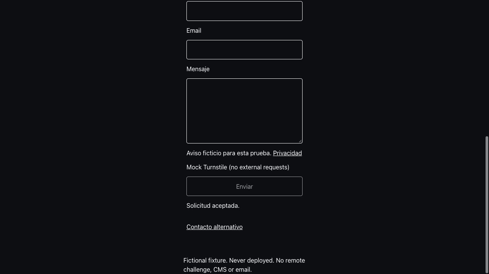

# Contacto: revisión local de navegador — 18 octubre 2026

Se usó el componente real `ContactFormFields.astro` y su controlador, extraídos del wrapper que consulta WordPress. El wrapper público conserva `getContactCopy`; los textos ficticios viven exclusivamente en `tests/fixtures/contact`, fuera de las rutas de producción. No se habilitó el endpoint ni se enviaron correos. Turnstile y respuestas de envío están simulados por un script local, sin challenge remoto.

## Evidencia observada

| Comprobación | Resultado |
| --- | --- |
| EN, tema claro, escritorio | Labels asociados, campos visibles, botón desactivado hasta verificar |
| Formulario vacío tras challenge | Validación nativa enfoca Name y muestra requerido; contador sigue en cero |
| Teclado | Tab de mensaje a privacidad y después botón; Enter envía; foco final en contact-status |
| Aceptación | Una solicitud simulada; campos limpios y mensaje de aceptación |
| Entrega incierta | Conserva campos, bloquea envío; callbacks posteriores no borran el aviso |
| Límite de intentos | Mensaje ES, campos conservados y botón desactivado hasta nuevo challenge |
| ES, tema oscuro, contenedor 320 px | Formulario 304 px, scrollWidth del contenedor 320 px; sin desbordamiento del fixture |
| CSP en fixture compilado | Scripts y estilos cargan; envío simulado funciona; foco en estado tras aceptar |

La revisión encontró texto heredado con poco contraste en tema claro; se asignó `--gray-0` al formulario y título, y se subrayaron enlaces. El input en navegador resulta rgb(5,12,156) sobre blanco. Se cambió Turnstile a `size: flexible` y el margen del formulario a 8 px por lado a 320 px, para disponer de 304 px frente al mínimo de 300 px del widget. El mock no reproduce el iframe real: su ajuste final requiere challenge real en staging.

## CSP

Configuración compartida `src/data/content-security-policy.js` mediante CSP nativa de Astro. Scripts propios y dominio exacto de Turnstile permitidos; scripts inline generados requieren hashes de Astro; sin unsafe-inline ni unsafe-eval para scripts. Iframes limitados a challenges.cloudflare.com, form-action y base-uri propios, object-src none. Estilos externos de Google Fonts permitidos; estilos en atributos conservados de forma explícita para layouts editoriales/variables existentes. No se configura default-src ni se presenta esto como una política exhaustiva para todos los recursos.

El arranque de tema pasó de script inline a `/theme-init.js`, manteniendo ejecución bloqueante en head y selección antes de pintar. El fixture usa un bootstrap externo exclusivo de QA. Astro aplica la política al compilar; no sirve usar únicamente dev para certificarla. SSR usa cabecera CSP y las páginas estáticas meta CSP. El smoke `--check-csp` acepta ambas y valida los hashes de cada script inline ejecutable.

Referencia: [Cloudflare: CSP de Turnstile](https://developers.cloudflare.com/turnstile/reference/content-security-policy/).

## Privacidad y pendientes

Consulta autenticada de solo lectura confirmó que la URL editorial EN es `https://valexlinks.com/privacy`. La herramienta web no pudo abrirla; no se certifica HTTP, contenido ni cobertura de este formulario. No se cambió el CMS. Antes de activar, verificar que el destino exista y explique responsable/finalidad, correo y Turnstile de Cloudflare, metadatos HMAC y retención; ajustar el enlace/textos desde WordPress si corresponde. No se publicaron textos legales inventados.

Pendientes: viewport móvil real/dispositivo, zoom 200–400 %, lector de pantalla, iframe/challenge real y comportamiento de red de Turnstile, validación remota de bindings y entrega autorizada. Contenedor estrecho y árbol de accesibilidad no sustituyen esas pruebas. ES usa textos ficticios de QA; traducción editorial real todavía pendiente.

## Reproducir

- `npm run dev:contact-qa`: servidor aislado en 127.0.0.1:4333, rutas `/` y `/es-mobile-dark`.
- `npm run build:contact-qa`: compila fixture con CSP en `tests/fixtures/contact/dist`.
- Servir ese directorio con un servidor estático local para comprobar CSP; los controles Local simulation permiten verificar/expirar/fallar el widget y seleccionar respuesta.
- `npm test`: 127 pruebas pasan; builds de staging y producción correctos. Smoke de siete páginas correcto con identidad CMS, SEO, renderer editorial y CSP/hashes; favicon y dos controles 404 también correctos. Comando: `node scripts/smoke.mjs http://127.0.0.1:4335 --require-cms-auth --check-seo --check-content --check-csp`.

Nunca desplegar el fixture ni usarlo como validación del proveedor: su fetch está simulado y no prueba backend ni entrega.
