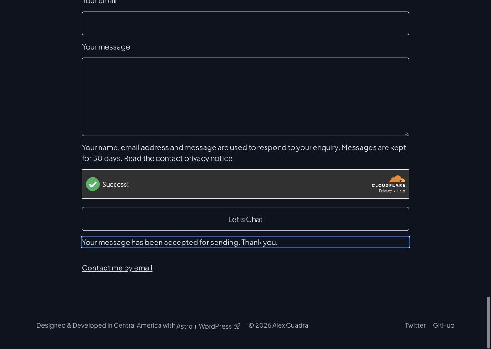

# Piloto de contacto 2 — 26 octubre 2026

**Completado:** Alex autorizó una sola prueba y confirmó «Recibido y Reply-To correcto». El correo llegó y Responder a muestra `alex@alexcuadra.dev`. Formulario nuevamente desactivado, sin cambios de producción.

## Ejecución y evidencia

- Fuente de aplicación: corrección Siteverify `63a6403`; sin nuevo código ni rebuild para esta ventana, se desplegó el artefacto validado.
- Apertura temporal en staging mediante override CONTACT_FORM_ENABLED=true: versión `c8e5a165-afee-41ba-93f9-a394de0c532e`. Configuración del repositorio conservó false. No se cambiaron secretos, destinatario, cuotas, DNS, permisos ni CMS/MCP.
- Mensaje ficticio CONTACT-PILOT-2, nombre Alex Cuadra, Reply-To público `alex@alexcuadra.dev`, asunto fijo Portfolio contact y destinatario del servidor. No se copia la dirección privada ni el cuerpo al recibo técnico.
- Una pulsación de envío mediante el formulario real del navegador. El widget Managed habilitó automáticamente el botón; no se hizo clic manual en un challenge ni se evitó la verificación.
- Evento del servidor: **26 octubre, 09:25:10 Nicaragua / 15:25:10 UTC**, requestId `df7eb098-f915-4d25-9e04-7734fa71b0b0`, **202 CONTACT_ACCEPTED**. Etapa delivery, deliveryStatus accepted, duración1959ms. Siteverify verified/HTTP200/duración15ms.
- Observador Wrangler conectado antes del clic: conservó solo el evento estructurado contact_result, sin guardar logs crudos/cabeceras/IP/cuerpos. Un evento observado de la prueba; ningún reintento por el agente. Observador detenido tras el resultado.
- UI mostró «Your message has been accepted for sending. Thank you.» y limpió los campos. La aceptación del proveedor se confirma con el log; la recepción y Reply-To con la respuesta explícita de Alex. No se envió una respuesta para comprobar Reply-To: bastó su inspección.

[Recibo técnico saneado](contact-pilot-2-result-2026-10-26.json).

## Cierre

Despliegue sin override, con CONTACT_FORM_ENABLED=false: versión **`f1caee3b-a837-4db2-ae1e-4680cd8635e6`**. [GET posterior](contact-pilot-2-closed-2026-10-26.json) devuelve404 CONTACT_DISABLED/no-store. La portada real recargó correctamente sin formularios ni iframes Turnstile. Sesión/tab de trabajo conservada. No quedó una ventana de envío abierta.

Producción continúa en `feba64f8-5406-4c69-8522-6c3753681a37`, con contacto desactivado. Este piloto no configura sus bindings ni autoriza activación permanente.

## Alcance cerrado y siguiente paso

Validado el recorrido real EN: token del widget → Siteverify → reserva → binding de correo → recepción/Reply-To. La corrección de redirect permite completar Siteverify real. No se atribuye al piloto una solución del429delCMS ni aceptación integral del sitio; revisión EN/ES de accesibilidad y configuración/activación de producción siguen separadas.

Siguiente contacto: preparar y revisar los bindings/configuración de producción y comprobar el formulario ES antes de una activación permanente autorizada. No repetir automáticamente otro envío. La ampliación MCP editorial de posts/traducciones/taxonomías permanece en el alcance de los siguientes incrementos.
