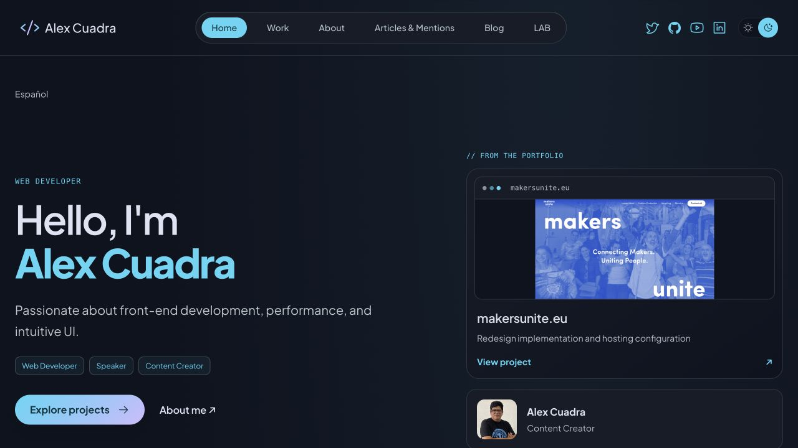

# Entrega visual en staging — 24 octubre2026

Desplegado desde6ea5414d90255bb474a8e0b8a7c0fb92490b6fae, Worker `alexcuadra-dev-staging`, versión **a35f2c0d-b218-44bf-8ae9-72c156f9abad**. Versión previa identificada:1b12660e-22b5-4e0d-8120-cf89c4ab60e5. No rollback realizado. Producción y CMS sin modificaciones. Contacto=false, Durable Object/export/bindings conservados. No SSH/SCP ni Docker.

## Resultado

Publicados conjuntamente proyectos, hero/perfil compacto, Motion, especialidades/LAB, canales editoriales/CTA y selección de proyectos por idioma. Build174archivos sin diagnósticos Astro; avisos Shiki/CSP conocidos. Configuración generada comprobada:solo staging, ninguna ruta de producción, autenticación=true y contacto=false. Despliegue1511.92KiB/gzip357.84KiB, startup31ms; no es benchmark de navegación.

Smoke remoto con1500ms entre peticiones completo:404técnicos, HomeEN/ES, ficha EN MakersUnite y ES Alextecuenta, canonical, alternates recíprocos, renderer/H1, hashes CSP y ausencia de formulario/widget. Endpoint de contacto404/no-store/CONTACT_DISABLED. Ajustado el comprobador que aún exigía proyectosEN en HomeES:ahora exige rutaES, rechaza tarjetasEN y visita su fichaES. Solo script de QA, no requiere otro despliegue.

Navegador remoto HomeEN oscuro1280CSS sin desbordamiento. Asset Motion200,9794B y hash idéntico al build. Observada tarjeta durante entrada(opacity0.923348/translateY2.62806px), después opacity1/transformnone y estilos restaurados. Consola inicial sin errores/advertencias; no afirmar que toda la sesión posterior quedó sin errores HTTP. No se desactivó CSP.

## Límite encontrado después del smoke

Archivo `/articles/` mostró indisponibilidad; una comprobación posterior devolvió503,Retry-After60,no-store,noindex/nofollow y cuerpo saneado. Observación temporal de logs confirmó CMS_HTTP429 en LocalizedHome de otras invocaciones Home durante ese intervalo; **no se capturó la operación específica que falló en artículos**. Esto demuestra limitación upstream activa, no permite atribuir cada503 a una misma consulta. Observador cerrado y logs crudos no guardados en el repositorio. Recibo solo con proyección técnica en el JSON adjunto.

No hubo ráfaga de reintentos, cambio de permisos, desactivación de protección ni rollback automático:el problema429 ya estaba registrado antes del cambio visual. No se certifican disponibilidad continua ni causa raíz corregida. Las comprobaciones que pasaron describen su momento de ejecución.

Artículos/LAB remotos y aceptación móvil/reduced-motionOS quedan pendientes. El navegador disponible no expone emulación de prefers-reduced-motion; se conserva evidencia previa del controlador con reducción de movimiento, sin presentarla como prueba de SO remoto. No repetir pruebas ya correctas por rutina ni retomar MCP para este diagnóstico.

Siguiente trabajo útil:resolver disponibilidad429 del CMS con evidencia de hosting y una pasada remota espaciada de las rutas pendientes; después aceptación final. Producción sigue separada. Para cualquier reversión considerar la versión previa identificada y preservar compatibilidad de Durable Object/configuración; no ejecutar scripts que restauren CMS o cambien contacto.

## Almacenamiento

Sin dependencias ni backups nuevos. Regeneración de dist existente y una captura/recibos pequeños.33GiB libres al cierre; la variación global desde34GiB no se atribuye a este trabajo sin evidencia. Servidores locales existentes conservados.
