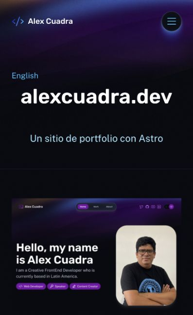

# Primera ficha real ES — 19 octubre 2026

- Auditoría de contenido EN: Christianity Today, alextecuenta, PlayYellow y Makers Unite no tienen cuerpo ni subtítulo. Portfolio, Norceca y Valexweb sí tienen contenido. Se pidieron a Alex rol/trabajo/tecnologías de Christianity Today; no se inventó una historia para esa ficha.
- Publicada traducción de portfolio alexcuadra.dev: entrada195 ES relacionada con50 EN, usando Add translation de Polylang. Traducidos texto existente y Project Tagline. Nombre, GitHub, sitio e imagen heredados; ninguna cifra o credencial añadida. Sin cambios a otros proyectos, categorías ni campos ACF.
- Slug real tras publicar: `alexcuadra-dev-2`; EN conserva `alexcuadra-dev`. GraphQL confirma contenido, idioma y relaciones recíprocas. La aplicación resuelve este slug desde el CMS sin adivinarlo.
- Staging existente `d69d5315-55b3-4632-a60a-b89a63d146f8` muestra tarjeta en `/es/proyectos/` y ficha en `/es/proyectos/alexcuadra-dev-2`. No hubo nuevo despliegue de Worker.
- Smoke nuevo `--require-cms-auth --check-seo --check-content --check-csp --check-contact-disabled --check-projects-es --projects-only` pasa: Home, listadoES, fichaES y fichaEN; idioma, contenido, GitHub, canonical/CSP y alternates recíprocos. El flag histórico `--check-projects-es-empty` ya no aplica al estado publicado actual.
- Navegador confirma navegación desde tarjeta y selector ES→EN→ES. DOM español con un H1 y un renderer editorial; a397px scrollWidth=clientWidth, sin desbordamiento. No se repitieron build/pruebas unitarias porque el código de aplicación no cambió en este incremento; cambió contenido CMS y smoke.
- CMS compartido actualizado; sin despliegue producción ni correo. Contacto desactivado.

Pendiente: traducir restantes fichas con contenido, completar casos editoriales ausentes y revisión visual integral de escritorio.

