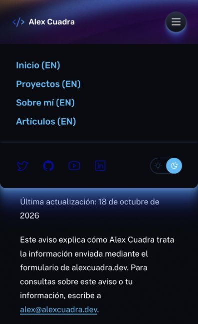

# Navegación bilingüe — staging, 19 octubre 2026

Versión desplegada: `bfd8ba5d-a263-40cc-826c-94d63de16481`.

Layout transmite idioma a Nav, Footer y ThemeToggle. En español: nombre accesible Navegación principal, Menú, Tema oscuro y pie traducido. Las cuatro secciones generales todavía están en inglés; los enlaces lo indican con `(EN)` y `hreflang=en`, conservando URLs existentes. No se añade una Home española vacía ni se adivinan traducciones del CMS.

Corregida etiqueta social LinkedIn, errata inglesa Central America y relación aria-controls del botón móvil. Escape cierra el menú móvil y devuelve foco al botón; no colapsa navegación de escritorio.

134 pruebas unitarias pasan; build correcto. Smoke ampliado con `--check-privacy-es --check-shell-es` para textos del shell, controles y ausencia de enlaces hacia templates ES inexistentes. Producción y CMS sin cambios, contacto desactivado y prueba de correo aplazada.

Pendiente: templates y contenido real ES, navegación hacia ellos cuando existan y revisión completa de accesibilidad.

Navegador móvil: menú abierto con cuatro destinos EN, LinkedIn correctamente identificado y control Tema oscuro. Escape desde un enlace deja aria-expanded=false y foco en Menú. Footer español verificado en DOM. Smoke de nueve páginas pasa, incluidos CSP y endpoint de contacto desactivado. No se declara QA de escritorio o lector de pantalla completa.

