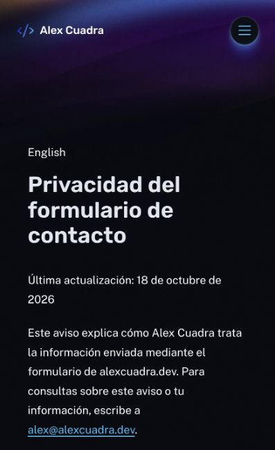

# Privacidad bilingüe en staging — 19 octubre 2026

Versión final: `733f8dfd-d7db-48c9-9e92-4d9dfc13eb42`. Vista móvil de 397 px comprobada sin desbordamiento horizontal (scrollWidth=clientWidth).

- EN: `/privacy/`, fuente explícita 180. ES: `/es/privacidad/`, fuente explícita 182 configurada solo en staging.
- Cada lectura exige ID exacto, idioma esperado, estado publicado, ausencia de contraseña/restricción y título/contenido no vacíos. Traducción ausente o inválida devuelve 404/no-store/noindex; no se usa inglés como reemplazo.
- Renderer editorial compartido y sanitizado. `html lang`, canonical de producción por ruta y alternates recíprocos EN/ES; enlace visible al otro idioma solo si ambas fuentes pasan validación. Se conserva idioma español sin inventar región Open Graph.
- 134 pruebas unitarias pasan, incluyendo rechazo de fuente ES inglesa/protegida/borrador/ID incorrecto. Build staging pasa con cero errores y seis hints legacy.
- Smoke remoto con `--require-cms-auth --check-seo --check-content --check-csp --check-privacy --check-privacy-es --check-contact-disabled` pasa: contrato desactivado, nueve páginas, contenido español y alternates.
- Navegador confirma contenido publicado y navegación ES→EN. Título ajustado para evitar desbordamiento móvil.
- No hubo edición CMS, correo ni despliegue producción. La navegación global sigue en inglés y el resto de templates ES permanece pendiente; esto no cierra la fase bilingüe.

