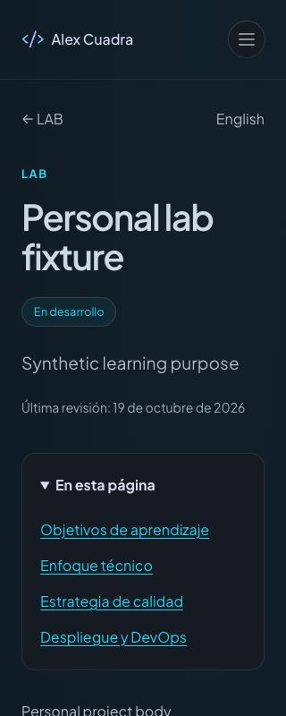

# Consolidación y aceptación parcial — 24 octubre 2026

## Resultado

La entrega pública sigue siendo `6c82a0d4-51b0-4f0e-a683-a8b2e65426b3`. Esta sesión consolida en Git el incremento ya publicado y sus recibos; no publica otra versión. El código de aplicación no cambió respecto a la publicación anterior. Huella SHA256 de `src/data/reference-inventory.js`: `1c41e8c4cd63e049de45fccddad846b79b00c786889a55007e604bf01917e60f`.

## Producción real

Navegador integrado a320×800CSS, devicePixelRatio1. Home EN y ES y archivo de proyectos ES: innerWidth320/scrollWidth320, sin desbordamiento horizontal observado. Portadas y tarjetas mostradas con texto e imágenes reales. Menú EN abre con Enter; Tab lleva a Home con foco visible; Escape cierra y devuelve el foco al botón. Skip to content lleva el foco a main-content. Cambio a ES y entrada al archivo de proyectos realizados con Enter. Esto no certifica todos los elementos de cada página ni un recorrido integral de teclado.

La navegación siguiente, a `/es/proyectos/alextecuenta-com-2`, mostró `Content is temporarily unavailable. Please try again later.`. Se guardó captura y se detuvieron nuevas visitas al CMS. Es la pantalla saneada de indisponibilidad del transporte; no se capturaron cabeceras, operación fallida ni logs de Worker en este intervalo. No atribuir esta observación específicamente a429 sin correlación. La incidencia histórica de límites sigue abierta.

- [Home EN a320CSS](acceptance-home-en-320-2026-10-24.png), captura completa sin forzar todas las imágenes lazy.
- [Indisponibilidad de la ficha real](acceptance-cms-unavailable-2026-10-24.png).

## Comprobación local independiente del CMS

Servidor aislado4408 con componentes reales y datos sintéticos; detenido al terminar. Archivo/ficha de proyectos ES y archivo/ficha LAB ES: innerWidth320/scrollWidth320. Ficha e índice LAB legibles; Espacio colapsa el índice y Enter lo abre. Enter en Objetivos de aprendizaje lleva el foco a `wp-content-lab-learning-goals`.

Se detectó una incoherencia exclusiva del fixture: archivo LAB ES enlazaba `/es/laboratorio/training-lab`, mientras la ficha sintética declaraba EN para ese slug. Corregidos los slugs españoles de ambas páginas del inventario y su resolución de idioma. La regresión SSR ahora sigue los enlaces reales de archivos LAB EN/ES y comprueba200 en sus destinos, además de los contratos existentes. Suite SSR completa correcta. No hubo cambio editorial ni corrección de rutas productivas.

16 pruebas específicas correctas: cinco del controlador de movimiento (incluyen preferencia reducida y cancelación/limpieza) y once del contrato de caché de referencias. No se repitió una compilación de producción: solo cambiaron fixtures, comprobaciones y documentación desde la última publicación verificada.

## Límites y siguiente paso

Aceptación final sigue abierta. Zoom200% real y preferencia de movimiento del SO no certificados: el navegador integrado expone viewport, no emulación de medios/zoom; acceder al Chrome nativo agotó el tiempo y reinició el control, sin prueba completada ni ajustes del SO. No equiparar viewport estrecho con zoom ni pruebas unitarias con emulación de SO. No se revisaron lector de pantalla, todos los canales editoriales ni LAB productivo en esta pasada. Se restauró el viewport predeterminado.

No se enviaron formularios ni se modificaron CMS, permisos, DNS, contacto o despliegues. No se hizo push: la consolidación es local y no activa builds remotos. Siguiente: resolver la disponibilidad del origen; después reanudar solo las rutas y escenarios pendientes, conservando las comprobaciones ya realizadas. Una página correcta aislada no cierra la disponibilidad sostenida.
