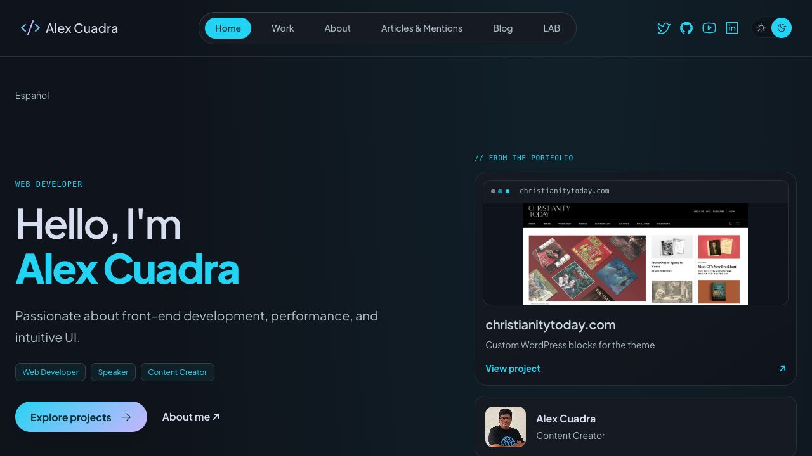

# Publicación de producción — 24 octubre 2026

Alex autorizó publicar con el bloqueo de disponibilidad 429 aún abierto y la aceptación integral pendiente. Se publicó el rediseño y el incremento de caché de referencias desde `c6c6f9feb8425e36f7fe530f0d14f7eac41b80bd` más los cambios locales documentados en `CMS_AVAILABILITY_INCREMENT_2026-10-24.md`; en el momento de publicación esos cambios no tenían commit propio. No presentar el SHA base como árbol exacto de la entrega.

## Recibo

- Worker: `alexcuadra-dev`; dominio: https://alexcuadra.dev/.
- Versión: `6c82a0d4-51b0-4f0e-a683-a8b2e65426b3`, tráfico confirmado al 100%.
- Deployment: `fa211712-0dcc-4c73-98e8-f41d86d72b54`, 2026-10-25 04:10:24 UTC (24 octubre, 22:10 en Nicaragua).
- Versión anterior identificada: `0739b280-1c56-436d-ab28-603970271293`; no reversión realizada.
- Compilación `npm run build:production`: 175 archivos, cero diagnósticos Astro. 256 pruebas unitarias correctas. Avisos Wrangler por bindings no heredados de staging: formulario sigue desactivado y producción no incorpora sus recursos de contacto.
- Configuración generada comprobada antes del deploy: nombre de producción, custom domain correcto, autenticación CMS=true, contacto=false, keep_vars=true. Desplegado explícitamente con `--config dist/server/wrangler.json`.
- Subida 1511.45 KiB/gzip357.41 KiB; startup16ms (no benchmark de navegación).

## Verificación posterior

Smoke HTTP terminado con exit0 y solicitudes separadas por3000ms, sin reintentos: favicon/404 técnicos, Home EN/ES, fichas Christianity Today EN y Alextecuenta ES, archivo de proyectos, About, artículos/canal Medium/ficha Gutenberg. Canonical, alternates de Home/proyectos, CSP/hashes de scripts, renderer compartido y un H1 en fichas correctos. `/api/contact`404/no-store/CONTACT_DISABLED; sin formulario/widget público.

Lectura posterior de Home: HTTP200, X-CMS-Auth verified, sin noindex en cabecera o meta y hero nuevo presente. Navegador1280×720 muestra el rediseño, imágenes y contenido real; captura adjunta. No se modificó WordPress, DNS, permisos de CMS ni staging.

## Pendientes conservados

El 429 del hosting no está resuelto: las respuestas correctas de esta comprobación describen su intervalo, no disponibilidad sostenida. La caché de referencias reduce llamadas; no se midieron sus HIT en producción ni se afirma que elimine el límite. LAB EN/ES se revisó en staging en el incremento anterior; esta pasada de producción no certifica esas rutas, todas las referencias, sitemap, móvil320px, zoom200% ni movimiento reducido del SO. La autorización de publicación no equivale a completar esa aceptación. MCP editorial sigue aplazado.

Para revertir, inspeccionar primero el deployment vigente y la compatibilidad de configuración/secretos; usar la versión anterior explícita si sigue siendo apropiada. No ejecutar el runner de recuperación de staging contra producción ni restaurar CMS como parte de una reversión de frontend.
