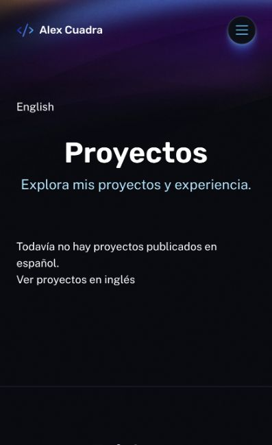

# Proyectos por idioma — 19 octubre 2026

Staging: `d69d5315-55b3-4632-a60a-b89a63d146f8`.

- Lectura autenticada de colección ES confirma cero proyectos publicados. No se crearon traducciones ni se modificó WordPress.
- ProjectsPage sirve `/work/` y `/es/proyectos/` con consultas paginadas y filtro EN/ES, canonical, lang y alternates recíprocos de listado. ES muestra ausencia de proyectos traducidos y enlace a inglés, sin copiar fichas EN a la colección ES.
- ProjectPage compartido por detalles EN y ES. Resolución desde colección pública del idioma; ausencia o slug de otro idioma devuelve404/no-store/noindex. Reemplaza el error500 legacy por proyecto inexistente. Alternates de ficha proceden exclusivamente de relaciones públicas validadas del CMS.
- Tarjetas generan rutas según idioma y admiten imagen ausente. Detalle admite ACF/imagen opcionales, retira placeholders ficticios y omite enlaces externos ausentes en vez de dirigir a404. Contenido HTML sigue sanitizado.
- Menú español enlaza su listado propio. Home ES mantiene tarjetas EN identificadas y sus destinos ingleses existentes; no se anuncian traducciones inexistentes.
- 134 pruebas pasan y build sin errores; tres hints legacy. Smoke focalizado con `--check-projects-es-empty --projects-only` verifica listado EN/ES, una ficha EN real, canonical/CSP, estado vacío ES, slugs inexistentes EN y slug EN bajo ES404, contacto false.
- Navegador móvil verifica listado español y enlace a inglés. No sustituye revisión visual de una ficha ES con contenido real aún ausente.

Sin despliegue producción, cambios CMS ni correo. Pendiente traducir proyectos reales y revisar sus fichas ES; Articles sigue pendiente de su decisión editorial.

