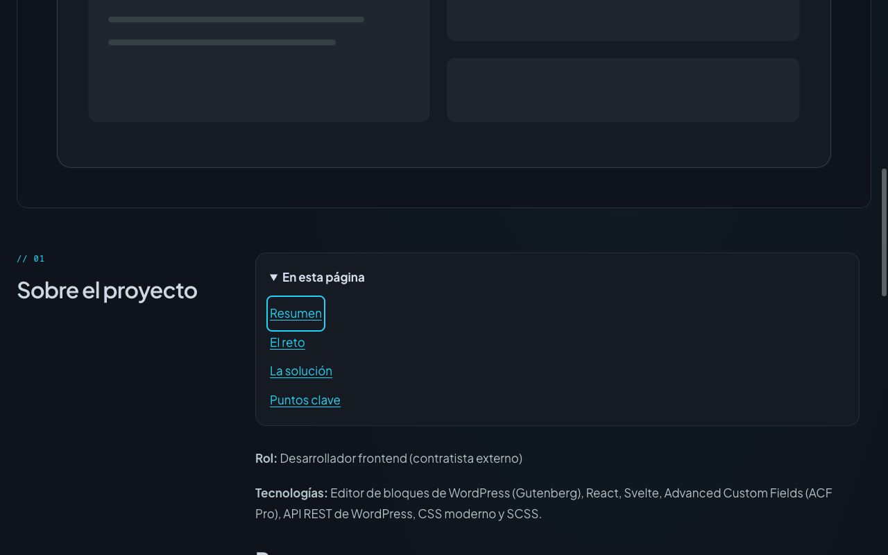

# Incremento de casos de proyecto — 24 octubre 2026

**Publicación editorial completada después de la preparación:** Alex aprobó ambos cuerpos e inició sesión. Se inspeccionó/guardó el código RAW Gutenberg de146/196 antes de escribir; EN cambió solo cuatro bloques H4→H2 y ES se serializó con bloques core paragraph/heading/list/list-item. WordPress confirmó Project updated en ambos. [Postflight público](PROJECT_CASE_STUDY_CMS_2026-10-24.json): prosaEN igual, traducciónES aprobada y cuatroH2 en cada ficha; conservados IDs/título/slugs/status/visibilidad/idiomas/ACF/imagen/tags/relaciones de traducción. No es una afirmación de preservación global de BD/postmeta. Editor visual restaurado. Sin grants, propuestas/revisiones operativas MCP ni cambios de permisos.

## Producto y propuesta editorial

`ProjectPage` habilita el índice nativo existente de `WordPressContent`, con etiqueta EN/ES. Aparece solo con dos o más encabezados no vacíos y conserva los IDs de fragmento anteriores del cuerpo. Sin nuevas consultas, dependencias, campos ACF o JavaScript. Las fichas breves y mínimas mantienen su presentación.

Alex proporcionó la descripción detallada de su trabajo para Christianity Today. Una consulta autenticada GraphQL de solo lectura (`ProjectCaseReviewSource`, una petición/dos proyectos) confirmó que EN146 ya contiene ese relato con cuatro H4 y ES196 sigue con dos párrafos breves. Se validó que ambos eran publicados, no restringidos, sin contraseña y del idioma esperado antes de guardar el snapshot público. No se imprimieron ni guardaron credenciales o respuestas de error crudas.

El conector WordPress se inspeccionó con un discover y un get-info: el lector público disponible expone identidad y traducciones, sin cuerpo. No se ejecutaron abilities ni se retomaron propuestas/revisiones/apply del sistema MCP aplazado. El cuerpo se leyó mediante la credencial GraphQL existente, sin ampliación de permisos.

[Revisión legible con el español completo](../wordpress/PROJECT_CASE_STUDY_REVIEW.md), [borradores](../wordpress/project-case-study-drafts.json) y [snapshot público](../wordpress/project-case-study-current.json). Propuesta EN: solo H4→H2, texto íntegramente igual comprobado por extracción de texto. ES: traducción del caso ampliado, sin cambios de título/subtítulo/URLs/imagen/relación. Las afirmaciones sobre experiencia, fidelidad y rendimiento proceden del texto de Alex; no son una medición independiente del agente. La aprobación de los dos cuerpos se ha solicitado después de preparar la revisión; no se ha escrito en el CMS.

El snapshot es HTML renderizado de GraphQL, no código RAW de Gutenberg ni respaldo de la BD. Antes de aplicar hay que releer el origen y usar RAW/editor para preservar los bloques, validar el diff y evitar sobrescribir cambios posteriores. No instalar ni ampliar permisos/MCP para resolverlo por inercia.

## Comprobaciones locales

16 pruebas relevantes de HTML/outline y regresiónSSR ampliada correctas. SSR cubre el cuerpo inglés vigente H4 con índice y sus anchors previos, ES breve sin índice, borradores EN/ES H2 con índice etiquetado y destinos de foco, una H1 y fichas mínimas sin índice. Sin acceso al hosting para estas pruebas.

Navegador local con componentes reales: propuesta ES a320CSS, scrollWidth320; Enter en La solución mueve el foco a `wp-content-body-body-la-solucion`. Espacio cierra el índice, Enter lo abre y Tab enfoca el primer enlace en escritorio1280CSS. Se restauró el viewport. La imagen, tags y rutas de la vista local son del fixture y no representan el CMS completo. No se certifican zoom200%, preferencia de movimiento del SO ni lector de pantalla.

[Lectura móvil y foco](project-case-es-local-320-2026-10-24.png).

## Entrega

Soporte de frontend preparado para staging; el recibo se añadirá después de compilar/desplegar la fuente consolidada. Los dos cuerpos aprobados ya están publicados en el CMS compartido y por ello son consumidos por staging y producción, sujetos al TTL de sus cachés. Producción conserva por ahora `1e47a630-d7f3-4afa-a8b0-8bd39ed09db2` sin el índice nuevo. El límite429 y aceptación integral permanecen abiertos; este incremento no los resuelve.
