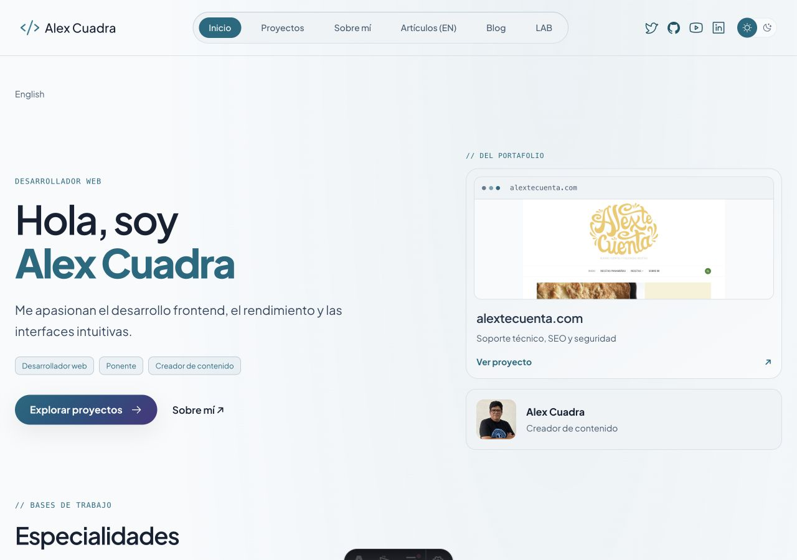
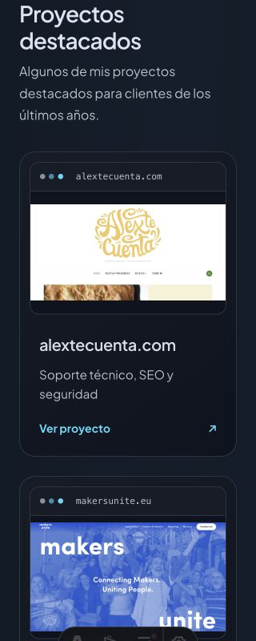
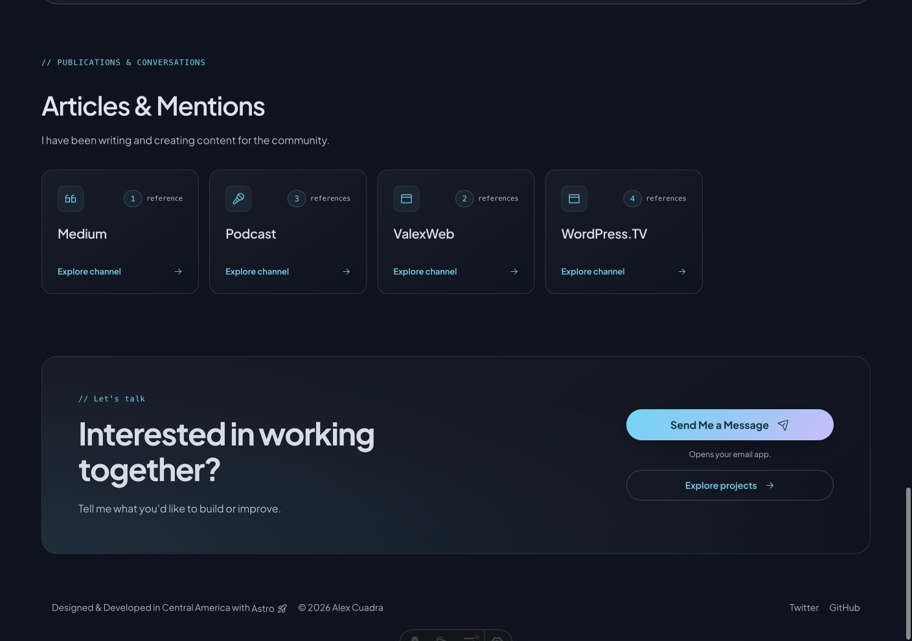
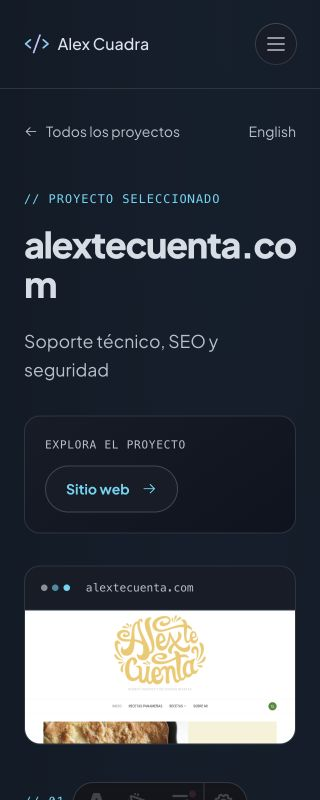
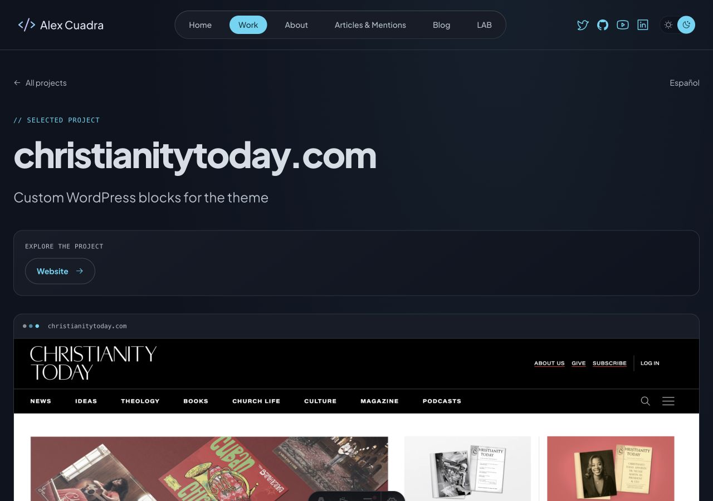

# Revisión con contenido real y entrega agrupada

24 octubre2026. Código local, sin despliegue ni escrituras WordPress. MCP editorial continúa aplazado. No SSH/SCP, Docker, envío de correo ni activación de contacto.

## Hallazgo corregido

HomeES solicitaba proyectosEN y enviaba al archivo inglés aun existiendo fichasES publicadas. Ahora solicita la colección del idioma actual, propaga locale a las tarjetas del hero/rejilla y enlaza el archivo correspondiente. Conserva cuatro recientes ordenados por modificación de cada idioma; las selecciones pueden diferir. No se realizan traducciones, escrituras ni búsqueda de fallback. Si no hay proyectos del idioma se informa explícitamente, sin presentar una ficha inglesa.

## Evidencia real

Servidor Astro4325 con configuración existente y contenido público real. Lecturas autenticadas mediante el flujo habitual; no se exportaron secretos, contenido privado ni dumps. La vista sintética4398 permanece disponible pero no representa la evidencia siguiente.

- HomeEN: Makers Unite, Alextecuenta, Christianity Today y portafolio; LAB real y canales Medium1, Podcast3, ValexWeb2, WordPress.TV4. Distribución1280/1408CSS observada sin overflow horizontal.
- HomeES corregida: hero Alextecuenta y cuatro fichasES con descripciones traducidas, rutas `/es/proyectos/...` y archivoES.320CSS y1280CSS: scrollWidth igual a innerWidth; ninguna imagen rota detectada en las imágenes cargadas. No se exige que EN/ES coincidan en orden o selección.
- Ficha AlextecuentaES abre con alcance confirmado, retornoES y traducciónEN;320CSS sin overflow. El dominio del título puede partirse en varias líneas en el ancho mínimo; no se oculta ni se recorta.
- Ficha ChristianityTodayEN presenta el alcance real de bloques WordPress, rol externo frontend y tecnologías confirmadas; no contiene métricas/SDET/plataforma de la maqueta.
- Tema claro de HomeES observado y oscuro restaurado. Sin formulario ni envío de correo.

Suite SSR con templates reales/fuente sintética correcta, ampliada para exigir proyectos/rutasES y rechazo de fallback en vacío. Build correcto174archivos Astro/0diagnósticos, avisos Shiki/CSP conocidos. No se repitieron baterías ajenas al cambio. Configuración de build inspeccionada mediante proyección pública: worker alexcuadra-dev-staging, main entry.mjs, contacto=false, autenticación=true, assets presentes y ninguna ruta de producción.

## Entrega preparada

Agrupar proyectos, hero/Motion, especialidades/LAB, canales/CTA y corrección de idioma en una única actualización de staging. El código está versionado; compilar nuevamente desde el commit final antes de desplegar para que build-info identifique la revisión correcta. Mantener contacto=false y la configuración de secretos existente.

No se ejecutó el despliegue. Tras desplegar: comprobar una pasada acotada de HomeEN/ES, ficha real de proyecto, artículos y LAB; verificar CSP/chunk Motion real, reduced-motion y navegación/foco, ausencia de formulario/Turnstile, metadatos/alternates y errores visibles. Si el hosting limita lecturas, respetar Retry-After y conservar503 saneado, sin ráfagas ni desactivar protección. Guardar identificador de versión y evidencia remota. Producción requiere su preparación y salida separadas.

Quedan fuera de esta aceptación parcial: zoom200%/lector y matriz integral de todas las páginas compartidas, postflight del Worker, incidencia429 histórica, filtros/búsqueda editorial y contenido profundo adicional de casos. No hace falta retomar MCP para completar esta entrega visual.

## Almacenamiento y continuidad

Sin dependencias, backups ni descargas nuevas. Cinco capturas suman282101B(≈276KiB). Tamaños observados al cierre:dist5.3MiB, .wrangler47MiB y cachéVite52MiB; son tamaños actuales, no crecimiento atribuido a esta sesión. Volumen34GiB libres frente a36GiB en la medición anterior; no se atribuye la variación global a estas capturas o al código sin evidencia. No se borró nada.

Servidor real4325 sesión22820 conservado para Alex. Pestaña realES marcada como entrega y viewport restaurado. Servidor sintético4398 previo conservado. Suite4399 cerrada.
