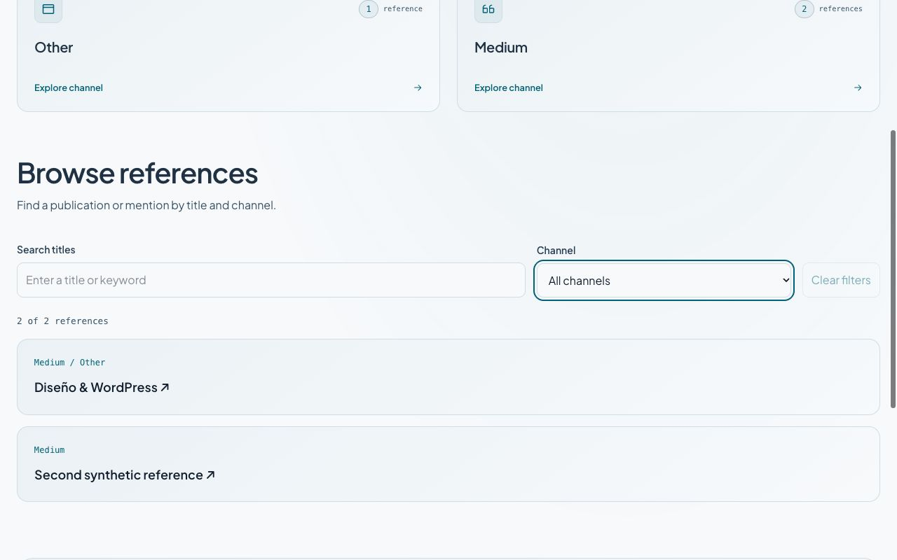
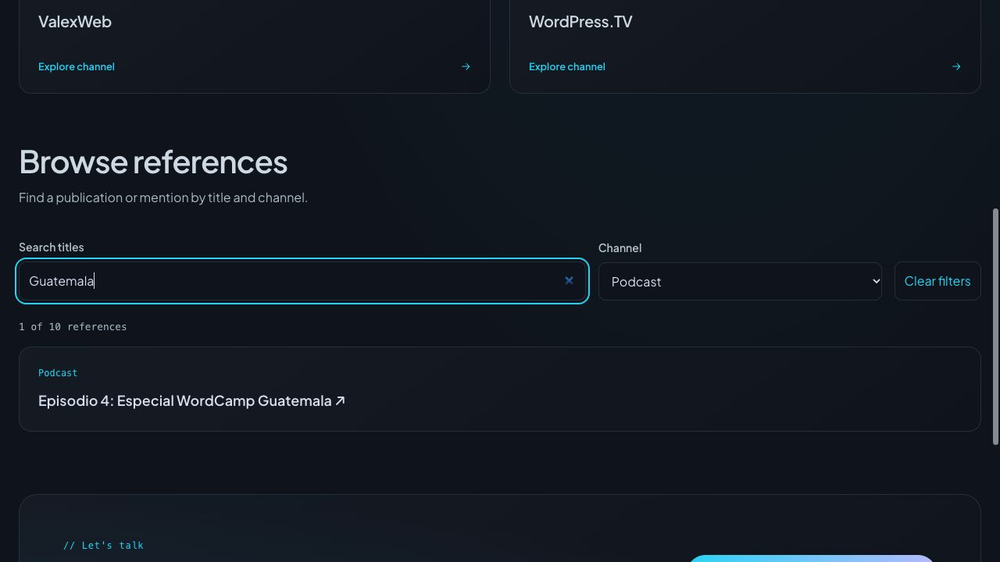

# Archivo editorial con búsqueda y filtros — 24 octubre 2026

## Cambio

`/articles/` conserva los canales y añade una lista de títulos públicos con enlace a sus fichas existentes. Búsqueda por título sin distinción de mayúsculas o acentos y filtro por canal combinables. Conteo con región de estado polite, mensaje sin resultados y limpieza que devuelve foco al buscador. No infiere autoría, fechas, destacados ni resultados de audiencia. Los títulos ausentes no se inventan: la referencia sigue contándose en su canal, pero no aparece en la lista por título.

La lista se renderiza en servidor. Sin JS conserva todos los enlaces y oculta los controles inoperantes; al activarse JS se filtra en el navegador, sin red, persistencia o parámetros de búsqueda enviados al servidor. El archivo de referencias sigue en inglés y conserva sus rutas históricas; no se creó una edición española de ese archivo.

## Datos y caché

La consulta existente `SitemapReferences` añade `title`. Su proyección conserva solo título de texto, slugs, relaciones públicas y cursores; sin cuerpos ni identidad. La clave ya incluye documento completo: la consulta nueva no reutiliza entradas anteriores sin títulos. Se mantienen TTL60s, validación de publicación/restricciones/contraseña, separación por credenciales y bypass. Se rechazan también slugs con traversal/separadores codificados o porcentajes malformados antes de generar enlaces.

Archivo y tarjetas comparten taxonomía/inventario. Una prueba verifica exactamente dos lecturas para ambos consumidores con conexiones de una página; archivos paginados mantienen sus lecturas adicionales ya existentes. No hay una consulta extra por resultado o por cambio de filtro. La portada recibe títulos como parte del inventario compartido, sin otra llamada ni cambio visual en Home.

## Validación local

262 unitarias correctas; regresión SSR ampliada correcta. Corregida su antigua suposición de que cualquier form era el formulario de contacto: ahora comprueba específicamente ausencia de data-contact-form y Turnstile. SSR verifica controles ocultos sin ejecución JS, región de estado, enlaces y resultados completos, estado sin referencias y errores503 existentes. Build staging:178archivos revisados,0errores/advertencias/hints Astro; aviso Shiki/CSP conocido.

Navegador sobre componentes reales con datos sintéticos: DISENO encuentra Diseño; canal Other combinado mantiene un resultado; Second+Other muestra cero y mensaje; Tab/Tab/Enter limpia desde el buscador, restablece2/2 y foco en reference-search.320CSS oscuro y1280CSS claro con scrollWidth igual a innerWidth, controles/resultados legibles. No certifica zoom200%, preferencia de movimiento del SO ni lector de pantalla. El nuevo filtro no añade animaciones.

[Vista móvil oscura](reference-directory-dark-320-2026-10-24.png).

## Entrega

Desplegado en staging desde el commit `6c3a3b7` (árbol limpio), versión **`f7445197-da24-4302-9873-117aab5c07d3`**, Worker `alexcuadra-dev-staging`. Versión previa identificada `a35f2c0d-b218-44bf-8ae9-72c156f9abad`, sin rollback. Artefacto generado comprobado: staging, sin rutas de producción, autenticación=true, contacto=false, coordinador/bindings conservados. Subida1521.03KiB/gzip359.84KiB. No push ni nuevo build por el recibo.

Lectura puntual `/articles/`:200,10entradas, identidad CMS verified, staging noindex, cuatro scripts inline ejecutables con hashes presentes en CSP, sin formulario de contacto/widget. Una navegación adicional en navegador confirmó10/10, selección Podcast3/10 y combinación Guatemala1/10 con el título real Episodio4. Todas las interacciones posteriores fueron sobre la página cargada, sin nuevas navegaciones al CMS.320CSS remoto con scrollWidth320; viewport restaurado. No se repitió el smoke global ni se capturaron logs upstream.

[Staging móvil](reference-directory-staging-320-2026-10-24.png). El servidor local4410 se detuvo y la pestaña sintética se cerró; se conserva la pestaña de staging para revisión.

Producción conserva `6c82a0d4-51b0-4f0e-a683-a8b2e65426b3`. El bloqueo429 y la aceptación final continúan abiertos; estos filtros no los resuelven. Sin mutación CMS, nueva dependencia ni activación del contacto. MCP editorial sigue aplazado.
