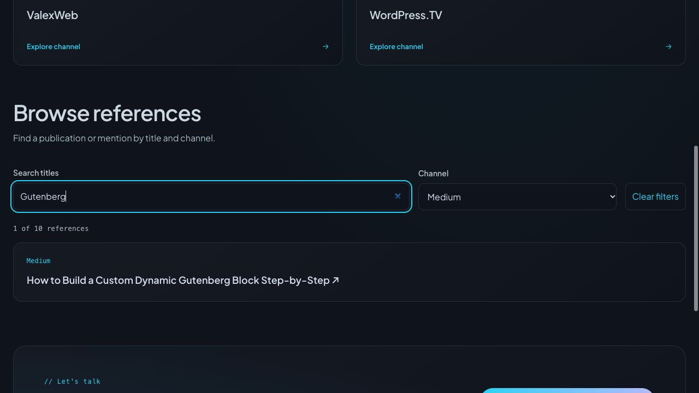

# Buscador editorial en producción — 24 octubre 2026

Promovido el incremento verificado en staging, sin cambios de aplicación adicionales. Fuente compilada: `06674e1` (árbol limpio); implementación `6c3a3b7`. Producción anterior identificada antes del deploy: `6c82a0d4-51b0-4f0e-a683-a8b2e65426b3`. No rollback realizado.

## Recibo

- Worker `alexcuadra-dev`, dominio https://alexcuadra.dev/.
- Versión **`1e47a630-d7f3-4afa-a8b0-8bd39ed09db2`**, tráfico confirmado100%.
- Deployment `b0cca747-f92f-40f3-b2de-5163d399d641`, 2026-10-25 04:59:59 UTC:24octubre22:59:59 en Nicaragua.
- `npm run build:production` correcto; artefacto generado comprobado antes de subir: custom domain exacto, auth=true, contacto=false, keep_vars=true y sin recursos de contacto de staging.
- Subida1519.38KiB/gzip359.27KiB; startup13ms, sin atribuirlo a rendimiento de navegación.
- Se conservan262unitarias y regresiónSSR correctas del incremento; no se repitieron por una promoción sin cambios de código.

## Comprobación acotada posterior

Una lectura HTTP de `/articles/` devuelve200 con10entradas, identidadCMS verified, canonical https://alexcuadra.dev/articles/, sin noindex en cabecera/meta y cuatro scripts inline ejecutables con hash presente en CSP. Sin formulario de contacto ni widget. Otra navegación en navegador carga10/10; Medium+Gutenberg muestra1/10 con la referencia real esperada. Un término inexistente muestra0/10/mensaje; Tab/Tab/Enter en limpiar restablece10/10 y foco en reference-search. Los filtros se probaron sobre el documento cargado, sin nuevas navegaciones al CMS. Se conserva la pestaña de producción para revisión.

No se repitieron todas las rutas ni se modificaron WordPress, DNS, permisos, staging o contacto. Sin push. La revisión móvil320CSS/claro/oscuro del incremento y el contrato sinJS constan en [QA de staging](REFERENCE_DIRECTORY_2026-10-24.md); no se presentan como una matriz nueva de producción.

## Pendientes

El límite429 del hosting y la aceptación integral (zoom200%, movimiento reducido del SO, lector y rutas restantes) siguen abiertos. El resultado200 observado no certifica disponibilidad continua. Siguiente mejora de producto: casos de proyecto con información verificable de contexto, contribución y decisiones; preparar contenido y revisar el diff antes de mutar el CMS. No inventar resultados, métricas ni funciones. MCP editorial continúa aplazado.

Una reversión del frontend exige inspeccionar primero el deployment vigente y compatibilidad de configuración/secretos; la versión anterior explícita queda identificada arriba. No usar el runner de staging contra producción ni restaurar el CMS como parte de esa reversión.
