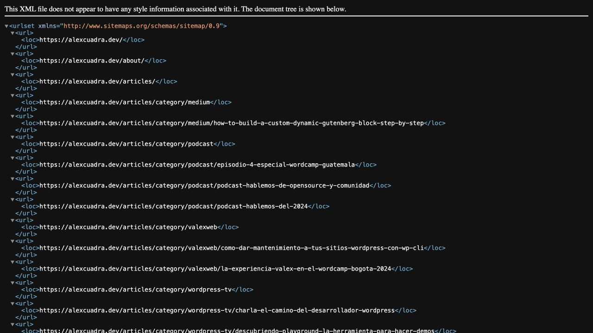

# Sitemap desde inventario público — 19 octubre 2026

Staging: `2579536c-a90d-46ee-8118-7ea012ac6ac4`.

- `/sitemap.xml`: XMLUTF8 con34 URLs únicas del dominio canónico,8 bajo/es/. Inventario actual:9 páginas/archivos,11 fichas de proyecto (7EN+4ES),4 categorías y10 referencias.
- Home/About resueltos desde relaciones públicas de Polylang, privacidad desde IDs configurados y proyectos desde colecciones paginadas por idioma. No se adivinan traducciones ni slugs. Páginas ausentes no se incorporan.
- Referencias conservan categoría y URL existentes sin reclasificarlas por idioma. Conexión raíz paginada. Categorías por referencia acotadas a100: si la conexión indica más páginas se rechaza el inventario con503 en vez de publicar uno truncado. No hubo cambios CMS.
- Inventario protegido/incorrecto, cursor repetido, fallo CMS, límite de tamaño o URL inválida impiden publicar un XML parcial. Los fallos CMS mantienen503/no-store/noindex. XML exitoso también no-store para no reutilizar un inventario obsoleto.
- Excluidos endpoints,404, parámetros, Blog provisional y LAB/rutas ES aún no implementadas. No se generan lastmod/priority/changefreq. Los alternates se mantienen en HTML; no se duplican en XML.
- `/robots.txt` permite lectura; solo anuncia `https://alexcuadra.dev/sitemap.xml` cuando se solicita en ese dominio. Staging conserva X-Robots-Tag noindex y no anuncia el sitemap. Robots no es control de acceso; no se alteró autenticación.
- 145 pruebas pasan: rutas de slugs reales, ausencia/traducción, público/protegido, XML/escape/límites, paginación y fallo503 sin XML parcial. Build correcto.
- Smoke `--check-sitemap --sitemap-only --save-sitemap /tmp/alexcuadra-sitemap-staging.xml` pasa; parser ElementTree confirma XML,34 URLs únicas y8ES. Navegador muestra árbol XML válido. Snapshot público en [sitemap-staging.xml](sitemap-staging.xml). No se rastrearon las34 URLs en esta ejecución.
- Producción no desplegada y Search Console no modificada. URLs del XML usan dominio final como canonical de las páginas de staging; esto es una revisión previa al despliegue de esas rutas en producción. Contacto permanece false.

Fuentes primarias: [protocolo Sitemap](https://www.sitemaps.org/protocol.html) y [versiones localizadas de Google](https://developers.google.com/search/docs/specialty/international/localized-versions). El protocolo permite omitir lastmod; cuando se use deberá proceder del cambio real de contenido.

