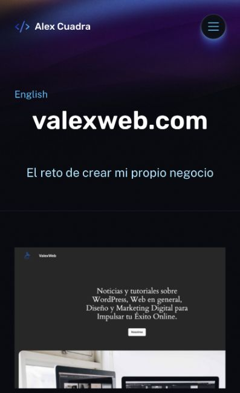
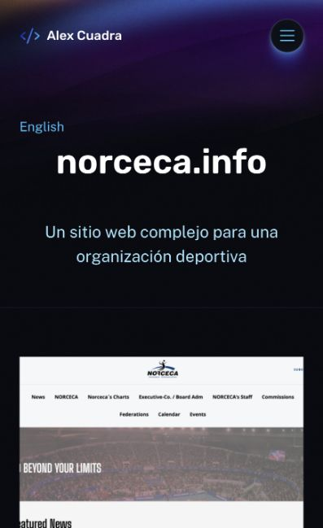

# Valexweb y Norceca ES — 19 octubre 2026

- Valexweb: traducción197 ES vinculada con43 EN, slug real `valexweb-com-2`. Cuerpo describe personalizaciones WordPress, tema basado en bloques y bloque personalizado para personalizar páginas; subtítulo El reto de crear mi propio negocio.
- Norceca: traducción198 ES vinculada con42 EN, slug `norceca-info-2`. Cuerpo describe personalizaciones ACF; subtítulo Un sitio web complejo para una organización deportiva.
- Publicadas mediante Add translation de Polylang, con imagen, enlaces y relaciones conservados. Originales EN sin editar. No se añadieron métricas ni responsabilidades. El GitHub de Norceca heredado apunta a `alexcu21/alexcu21`; no se certifica que sea repositorio del proyecto.
- GraphQL confirma ambos idiomas, cuerpos/subtítulos, recursos y relaciones recíprocas. Total actual ES: cuatro proyectos.
- Smoke `--require-cms-auth --check-seo --check-content --check-csp --check-contact-disabled --check-valexweb-norceca --projects-only` pasa: Home, listado y cuatro fichas EN/ES, contenido, renderer, canonical/CSP y alternates.
- Navegador confirma tarjeta y ficha Valexweb. Norceca tuvo respuesta con body vacío y luego503; la carga posterior con `?qa=render-check` se recuperó y permitió verificar contenido, imagen y CTA, un H1, lang=es y anchura397px sin desbordamiento. No se capturó error upstream de la solicitud fallida; tail comenzó después y la carga observada fue correcta. No atribuir automáticamente este episodio a429 ni declararlo resuelto permanentemente.
- Sin cambios de aplicación, build ni deploy nuevos; se reutiliza staging `b05945c8-00ff-477d-99e3-754b3e0f1648`. Publicación en CMS compartido; Worker producción sin desplegar, contacto false y sin correo.

Pendiente: estabilizar intermitencia; obtener contenido real de alextecuenta, PlayYellow y Makers Unite; continuar templates/editorial y rediseño visual del plan.

